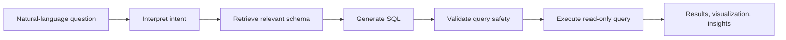
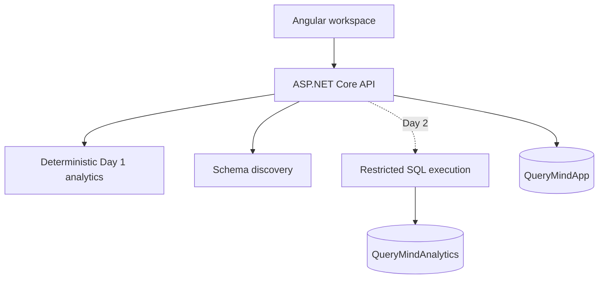

# QueryMind

> **Intelligence, grounded in data.**

QueryMind is an AI-powered analytics workspace being built to help users explore relational data through natural-language questions. It is a focused portfolio project demonstrating .NET, Angular, SQL Server, secure analytics boundaries, and deliberate product design.

> **Current milestone:** Day 1 foundation. Predefined analyses execute application-owned, read-only SQL Server statements. AI-generated SQL and generated insights are not claimed as implemented.

## Why QueryMind?

Business questions should not require hand-written SQL for every answer. QueryMind's intended execution path is:



The application, rather than an LLM, remains in control of schema access, SQL validation, resource limits, and database execution.

## What works today

- Interactive Angular analytics workspace with responsive navigation and light/dark themes.
- Suggested revenue, category, customer, region, and cancellation analyses.
- Lightweight natural-language intent matching to a bounded set of Day 1 analyses.
- Results canvas with a visualization, tabular data, SQL preview, and execution metadata.
- Schema Explorer backed by the API's curated schema contract.
- In-browser query history for the current session.
- SQL Server 2022 Docker environment with separate `QueryMindAnalytics` and `QueryMindApp` databases.
- Reproducible retail dataset: 2,000 customers, 100 products, and 10,000 deterministic orders.
- SQL Server `analytics_reader` login restricted to `SELECT` access on the analytics schema.

## Screenshots

Screenshots will be added from the running application after the current local preview is started. They will show actual UI states rather than mocked marketing imagery.

## Architecture

QueryMind uses a pragmatic modular monolith: one ASP.NET Core API and one Angular client, with deliberately separate application and analytics databases on SQL Server.



See the full [architecture notes](docs/architecture.md) and the [architecture decision record](docs/adr/0001-architecture-selection.md).

## Technology stack

| Area | Technology |
| --- | --- |
| API | .NET 10, ASP.NET Core Web API, C# |
| Frontend | Angular 20, TypeScript, Signals, SCSS |
| Data | SQL Server 2022, Entity Framework Core SQL Server provider |
| Local infrastructure | Docker Compose |
| Testing | xUnit foundation, Angular build/type checks |
| CI | GitHub Actions |

## Local development

### Prerequisites

- .NET 10 SDK
- Node.js 22 LTS
- Docker Desktop with Linux containers enabled

### Start the data environment

```powershell
Copy-Item .env.example .env
# Edit .env and set strong local passwords before continuing.
docker compose up -d
docker compose ps
```

This starts SQL Server on `localhost:1433`, creates both databases, seeds the analytics dataset, and creates the read-only analytics login.

### Start the API and frontend

Open two terminals:

```powershell
# Terminal 1
dotnet run --project src/QueryMind.Api
```

```powershell
# Terminal 2
cd web
npm ci
npm start
```

Open `http://localhost:4200`.

## Example questions

- How has monthly revenue changed?
- Compare revenue across product categories.
- Which customers have the highest lifetime value?
- Which regions are performing best?
- What percentage of orders were cancelled?

## Security model

The current database foundation is deliberately structured for restricted analytics access:

- Application and analytics data are isolated into separate SQL Server databases.
- A dedicated `analytics_reader` login receives `SELECT` access only to the analytics schema.
- Secrets are supplied through the ignored local `.env` file, never committed.
- Day 2 will treat all generated SQL as untrusted input and enforce a strict read-only validation and execution boundary.

## Roadmap

### Day 1 — Foundation

- [x] API and Angular workspace
- [x] SQL Server Docker topology and deterministic retail seed data
- [x] Schema contract and predefined read-only SQL analytics
- [x] CI and initial architecture documentation

### Day 2 — Secure AI analytics

- [ ] Configurable model provider abstraction
- [ ] Schema-aware natural language to SQL
- [ ] SQL Server query validation and restricted execution
- [ ] Bounded regeneration, grounded insights, and persistent history

### Day 3 — Evaluation and portfolio polish

- [ ] AI evaluation dataset and runner
- [ ] Observability and execution metrics
- [ ] End-to-end workflow coverage and deployment guide

## Known limitations

- Natural-language input maps to a bounded predefined analysis set, not arbitrary SQL.
- SQL statements are application-owned Day 1 queries; model-generated SQL is not yet supported.
- AI evaluation, model telemetry, and persistent history are planned work.
- The app is an MVP foundation, not a production-ready analytics service.

## Documentation

- [Architecture](docs/architecture.md)
- [Development setup](docs/development-setup.md)
- [Roadmap](docs/roadmap.md)
- [Day 1 development log](docs/development-log/day-01.md)
