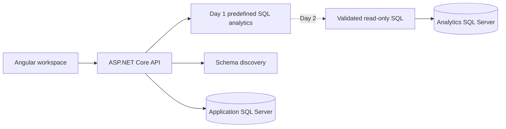

# Architecture

QueryMind is a pragmatic modular monolith. The API separates analytics contracts and predefined read-only execution from schema discovery. The Angular client consumes HTTP contracts and owns presentation state. SQL Server has separate application and analytics databases; the analytics schema has an explicit read-only login.

