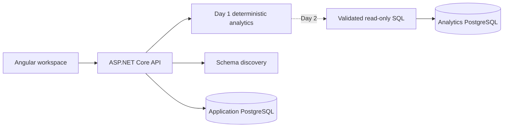

# Architecture

QueryMind is a pragmatic modular monolith. The API separates analytics contracts and deterministic execution from schema discovery. The Angular client consumes HTTP contracts and owns presentation state. PostgreSQL has separate application and analytics databases; the analytics schema has an explicit read-only role.

